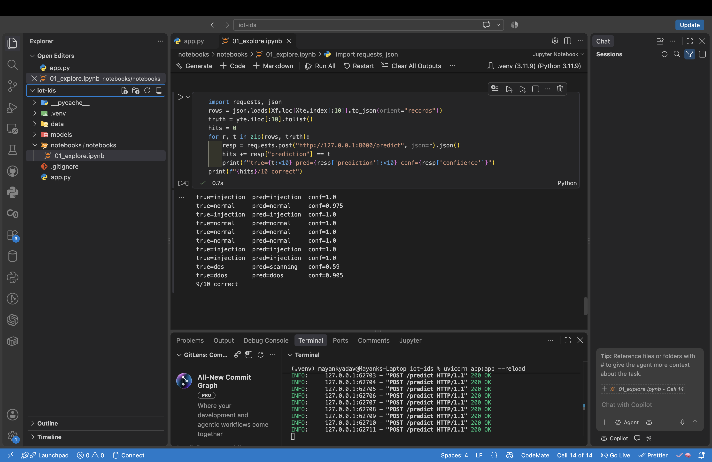

# IoT Intrusion Detection (TON_IoT)

ML detection of attacks in IoT network traffic, served through a FastAPI endpoint.

## Dataset
TON_IoT network dataset (UNSW Canberra), `train_test_network.csv`: 211,043 flows, 9 attack types plus normal. Used for academic purposes; cite Moustafa, N., "A new distributed architecture for evaluating AI-based security systems at the edge: Network TON_IoT datasets," Sustainable Cities and Society (2021). Download it from the UNSW TON_IoT page and place it in `data/`.

## Method
- Dropped identifier columns (source/destination IP, source port) and removed duplicate rows (211,043 → 105,621) to avoid inflated scores.
- Compared Random Forest and XGBoost; final model is a Random Forest with balanced class weights, trained without `dst_port` to avoid a port shortcut.
- 80/20 stratified split, 10-class classification.

## Results (deduplicated, no dst_port)
Accuracy 97.74%, macro F1 0.9561.

| Run | Accuracy | Macro F1 |
|---|---|---|
| Original (with duplicates) | 98.73% | 0.9624 |
| Deduplicated | 97.93% | 0.9595 |
| Dedup, no dst_port | 97.74% | 0.9561 |

Weakest classes: `mitm` (F1 0.78, 208 test rows), `xss` (0.94), `scanning` (0.96).

## Limitations
- Random split, not by capture session or time, so performance on a new network will likely be lower.
- Rare classes (`mitm`, `ransomware`, `backdoor`) have few test samples.
- Trained on one lab testbed.

## Run the API
```bash
python3 -m venv .venv && source .venv/bin/activate
pip install -r requirements.txt
uvicorn app:app --reload
```
Open `http://127.0.0.1:8000/docs` and use POST `/predict` with one flow record as JSON. The model file is not stored in the repo; run the notebook in `notebooks/` to regenerate `models/ids_rf.joblib`.

   